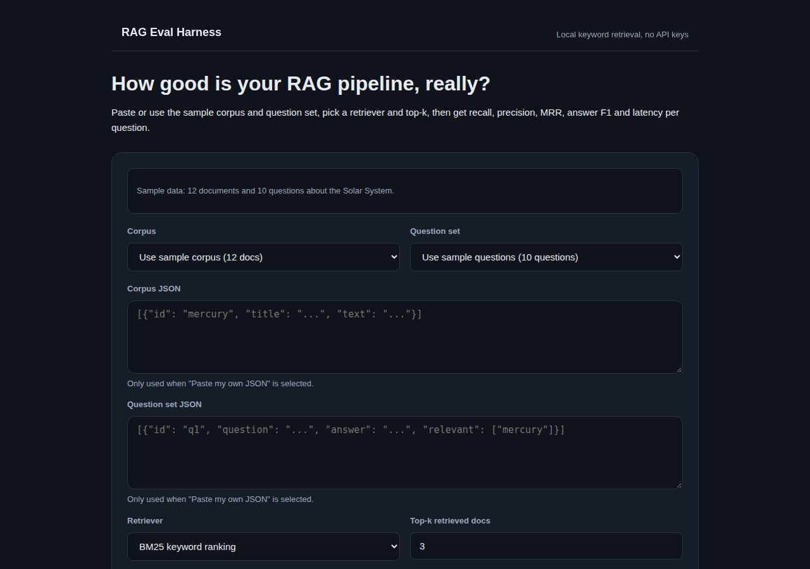
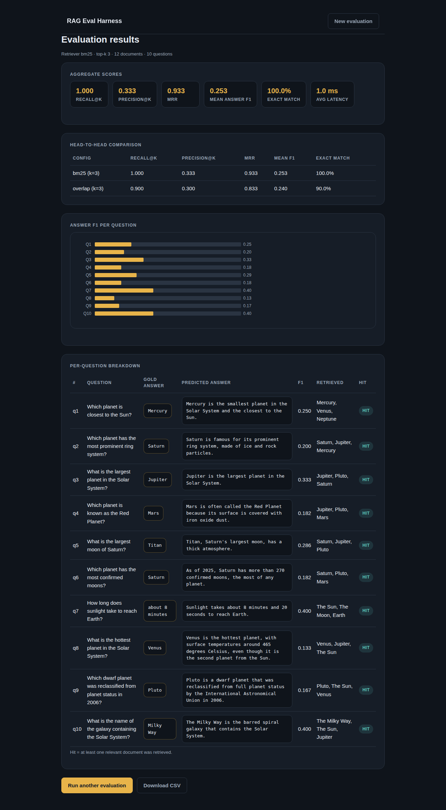

# RAG Eval Harness

A Flask web app that scores a small RAG pipeline the way you would in production: give it a document corpus and a question set with ground-truth answers, pick a retriever and top-k, and get recall@k, precision@k, MRR, answer F1, exact-match rate, and per-question latency — plus a head-to-head comparison against a second retriever. Everything runs locally with the Python standard library; no API keys, no external calls.





## How it works

- **BM25 retriever** — ranks documents with BM25 (k1=1.5, b=0.75) over tokenized text.
- **Term-overlap baseline** — a simple count-based retriever, so you can see what BM25 actually buys you.
- **Extractive answers** — picks the best sentence from the retrieved docs, scoring question terms by rarity (IDF) so generic words like "planet" don't outvote discriminative ones like "hottest".
- **Grading** — per question: recall@k, precision@k, hit/miss, token-level F1 and exact match of the predicted answer against the gold answer; aggregates include MRR and average latency.
- **Head-to-head** — run your config against the other retriever at the same top-k and compare the scorecards side by side.
- **Bring your own data** — paste a corpus (`[{"id", "title", "text"}]`) and question set (`[{"id", "question", "answer", "relevant": ["doc-id"]}]`), or use the bundled Solar System sample.

## Run it

```bash
python -m venv .venv
source .venv/bin/activate
pip install -r requirements.txt
python app.py
```

Then open http://127.0.0.1:5000 and click **Run evaluation**.

## Example output

Measured run of the bundled sample data (12 Solar System documents, 10 questions, BM25, top-k 3):

- **Recall@k 1.000 · Precision@k 0.333 · MRR 0.933 · Mean answer F1 0.253 · Exact match 100.0% · Avg latency 1.0 ms**
- Head-to-head at the same top-k: BM25 beats the overlap baseline on recall (1.000 vs 0.900) and MRR (0.933 vs 0.833); the baseline misses Venus entirely on "What is the hottest planet?"
- Per-question F1 ranges from 0.133 to 0.400 — extractive answers contain the gold answer but add surrounding words, which is exactly what token F1 penalizes.

## API

- `GET /api/evaluate?top_k=3&method=bm25&compare=1` — runs the sample data and returns JSON with `result`, `comparison`, `n_docs`, `n_questions`.
- `GET /export.csv?top_k=3&method=bm25` — downloads per-question results as CSV (`rag_eval_results.csv`).

## Tests

```bash
pytest tests/   # 30 tests, all green
```

Covers tokenization, BM25 ranking and top-k, the overlap baseline, IDF-weighted extractive answers (including a regression test for the "Red Planet" sentence pick), token F1 and exact match, eval aggregates and empty-input handling, config comparison, Flask routes, the JSON API, CSV export, and the F1 chart helper.
